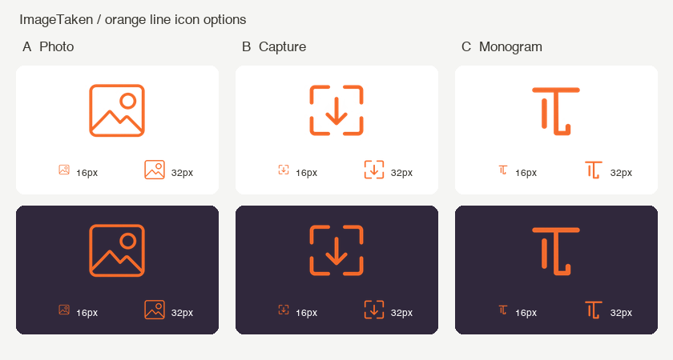
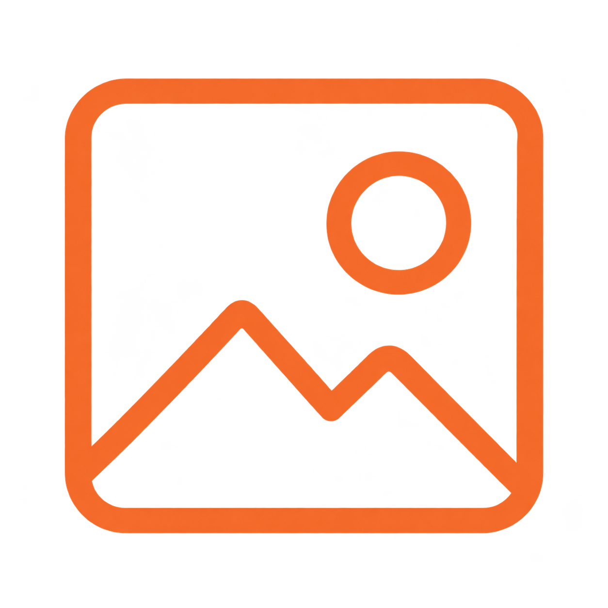
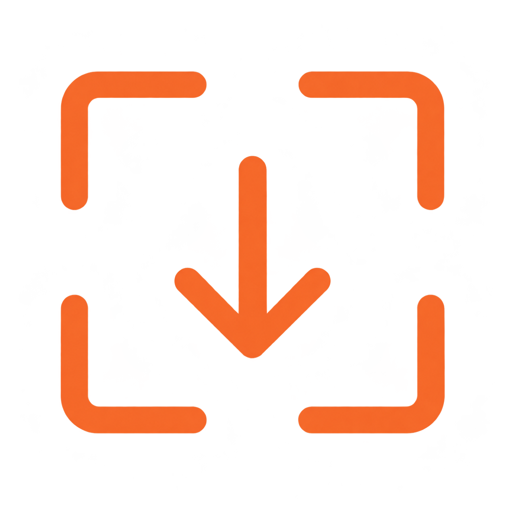
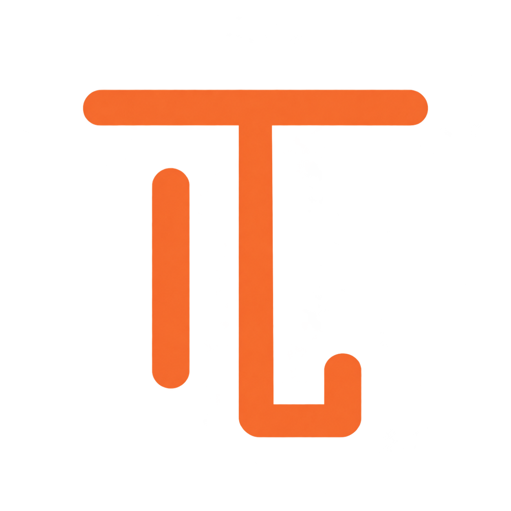

# ImageTaken 线条 Logo 备选

使用内置 Imagegen 工具生成的三个方案，均为橙色线条和透明背景，无白色实心块。当前仅作为备选展示，尚未应用到扩展。



## A · 图片框



```text
Use case: logo-brand. Create ONE original minimal LINE-ART Chrome extension icon for ImageTaken, a webpage image collector. Only clean saturated orange #F36A32 strokes on a truly transparent background. All geometry is outlined line work; absolutely no white pixels, no white fill, no solid filled pictogram, no background tile, no color blocks, no gradients, no shadows, no texture, no 3D, no tiny ornamental detail, no text labels. Consistent bold stroke weight around 9 percent of canvas width, rounded line caps and joins, generous internal negative space, strong recognition when reduced to 16px. Single centered orange outline symbol occupies 82 percent of square canvas; pristine vector-like clarity. Do not create a presentation board, only the standalone icon. Design A: One rounded-square photographic frame drawn as an orange outline, with a single simple mountain zigzag line inside its lower half and one small outlined circle sun in upper-right. All internal elements hollow and orange outline only. No arrow, no second frame, no extra marks. Balanced exceptionally simple picture icon.
```

## B · 取景采集



```text
Use case: logo-brand. Create ONE original minimal LINE-ART Chrome extension icon for ImageTaken, a webpage image collector. Only clean saturated orange #F36A32 strokes on a truly transparent background. All geometry is outlined line work; absolutely no white pixels, no white fill, no solid filled pictogram, no background tile, no color blocks, no gradients, no shadows, no texture, no 3D, no tiny ornamental detail, no text labels. Consistent bold stroke weight around 9 percent of canvas width, rounded line caps and joins, generous internal negative space, strong recognition when reduced to 16px. Single centered orange outline symbol occupies 82 percent of square canvas; pristine vector-like clarity. Do not create a presentation board, only the standalone icon. Design B: Four bold orange L-shaped viewfinder corners arranged as a square with open middles on every side. In the center, one simple downward pointing orange line arrow indicating capture/save. The arrow is only a vertical stroke and two diagonal strokes, no filled arrowhead and no tray. No mountain, no sun, no complete outer frame. Very minimal framing-and-capture symbol.
```

## C · IT 字母组合



```text
Use case: logo-brand. Create ONE original minimal LINE-ART Chrome extension icon for ImageTaken, a webpage image collector. Only clean saturated orange #F36A32 strokes on a truly transparent background. All geometry is outlined line work; absolutely no white pixels, no white fill, no solid filled pictogram, no background tile, no color blocks, no gradients, no shadows, no texture, no 3D, no tiny ornamental detail, no text labels. Consistent bold stroke weight around 9 percent of canvas width, rounded line caps and joins, generous internal negative space, strong recognition when reduced to 16px. Single centered orange outline symbol occupies 82 percent of square canvas; pristine vector-like clarity. Do not create a presentation board, only the standalone icon. Design C: A unique geometric monoline abstract IT monogram representing ImageTaken. A simple orange top horizontal stroke and a central vertical stroke form a T, paired with a short separate orange vertical stroke to its left forming an I. The T's vertical stroke ends in a small open right-angle hook suggesting taking/capturing. Exactly a few broad connected strokes, no filled typographic letter shapes, no enclosing frame, no picture, no arrowhead, no sun. This must look like a custom contemporary app symbol rather than printed text.
```

