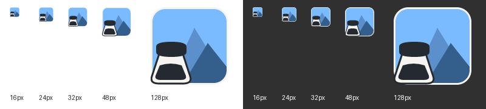

# ImageTaken Logo

当前 Logo 使用对话 [设计色块线条风格 Logo](codex://threads/01a15db3-f0cd-7193-a13b-a6df7d7848b3) 的最后生成产物：蓝色圆角画框、两个叠加山形，以及左下角的咖啡壶。

[原始产物](logo-source.png) 为 1315 × 1197 的透明 PNG，完整保留。部署时按可见图形范围去除透明留白，按比例铺满正方形画布并居中，不额外添加安全边距，避免 Chrome 工具栏图标显得过小。各尺寸直接从裁切后的原图生成，保留原图造型、颜色和轻微渐变。

项目主图：[imagetaken-logo.png](../extension/assets/imagetaken-logo.png)，1024 × 1024。扩展图标：[16 px](../extension/icons/16.png)、[32 px](../extension/icons/32.png)、[48 px](../extension/icons/48.png)、[128 px](../extension/icons/128.png)，均使用 Lanczos 缩放并保留透明度。扩展管理页、图片库、设置页、标签页及 README 使用这一原图版本。

使用 Pillow 重新生成全部尺寸及预览：

```sh
uv run --with pillow --with resvg-py python scripts/build-icons.py
```

深浅背景预览，下排展示实际 16 / 32 / 48 / 128 px 尺寸：


原始文件来自该对话的最终图像 `exec-121a4718-d14b-498d-b6c5-1ca2f68fb77f.png`。

Chrome 工具栏使用 [toolbar-logo.svg](../extension/assets/toolbar-logo.svg) 的小尺寸适配版：保留双山形与咖啡壶，缩薄外围边框，蓝色主体铺满图标区域，避免原图的粗深色边框在深色工具栏里融入背景。导出 16 / 24 / 32 / 48 / 128 px PNG，由 Manifest 的 `action.default_icon` 引用，与页面主 Logo 分开。


