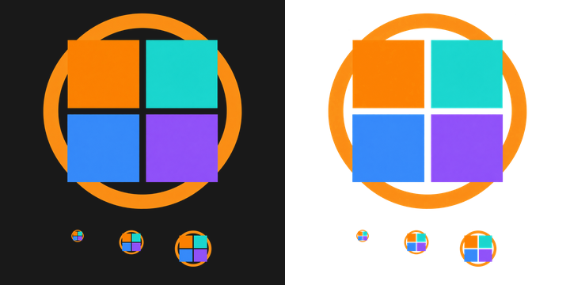

# ImageTaken Logo

当前 Logo 使用内置 Imagegen 生成并优化：亮橙色加粗空心圆环，前景四个等大实心正方形按 2×2 居中排列，横纵间距一致。左上橙色、右上青绿色、左下蓝色、右下紫色。放大的色块四角覆盖圆环，整体宽高仍小于圆环外径；留白处透明。

透明 PNG 原图：[imagetaken-logo.png](../extension/assets/imagetaken-logo.png)，1254 × 1254。图标尺寸：[16 px](../extension/icons/16.png)、[32 px](../extension/icons/32.png)、[48 px](../extension/icons/48.png)、[128 px](../extension/icons/128.png)，均由同一原图使用 Lanczos 缩放，保留 alpha。工具栏、标题栏、独立标签页及 README 已同步替换。

深浅背景下的完整图标及实际 16 / 32 / 48 px 效果：



当前亮橙色圆环提示词：

```text
Edit ONLY the circular ring color in this existing logo: replace green ring with bright vivid tangerine orange #FF941F, substantially lighter and brighter than cocoa brown. Preserve exactly the existing ring thickness, diameter, geometry, all four square sizes and their positions, gaps, and original orange turquoise blue violet colors. Four square blocks remain layered IN FRONT of the ring. Preserve transparency in all interior gaps and outside the circle. No other changes, no white background, no black spots, no stains or speckles, clean flat colors.
```

此前绿色圆环提示词：

```text
Change ONLY the brown circular ring in this icon to a vivid medium green #269B50. Preserve exactly the ring diameter, thick stroke, all geometry, transparent background, the four overlapping front squares, their sizes, equal spacing, positions, and their original orange, turquoise, blue, violet colors. Green ring remains behind the four squares. No other changes. Clean flat color, no new shapes, no text, no shadows, no stains, no black speckles, transparent interior gaps and exterior.
```

此前形状优化提示词：

```text
Refine this exact logo: retain a cocoa brown hollow circular ring and four solid equal sharp-corner squares in 2x2, orange upper-left, turquoise upper-right, blue lower-left, violet lower-right. ENLARGE all four squares substantially and DOUBLE the ring stroke thickness. The four-square group must be IN FRONT of the circular ring, so its four outer corners overlap and visibly COVER the brown ring along the diagonal quadrants. Ring remains visible as four thick curved arcs at top bottom left right. Precise proportions: circle outer diameter 92% of canvas, ring thickness 11% of canvas, centered square group total bounding width and height 76% of canvas, each square side 35% of canvas, equal horizontal and vertical gap 6% of canvas. Thus square group overall width and height are still LESS than circle outer diameter, but its diagonal corners cross the ring. Color squares layered ON TOP of ring, NOT clipped to circle, so their square outer corners remain sharp and intact. Perfect symmetry, equal square sizes, equal spacing. Pure flat solid colors, opaque shapes, transparent background and transparent gaps; no white fill, no gradients, no texture, shadows, stains or speckles. One finished icon only.
```
